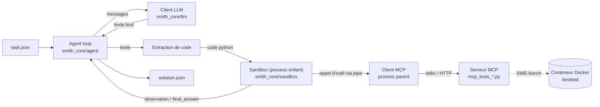

# Agent Smith — porte d'entrée

Un **agent de code** : un LLM écrit du **Python**, notre **sandbox** l'exécute, le résultat (l'*observation*) repart au LLM, et on recommence jusqu'à ce que le code appelle `final_answer(...)`. Les outils (lire un fichier, lancer des tests…) viennent d'un **serveur MCP** séparé et sont appelables comme des fonctions Python dans la sandbox.

Deux benchmarks : **MBPP** (petits exercices Python) et **SWE-bench Verified** (vrais bugs dans de vrais repos, dans Docker). Projet en binôme : **Sylvain** et **Thomas**. Objectif fixé : **le minimum acceptable de la partie mandatory**.

> Ordre de lecture conseillé : cette note → [[Explications - Lire en dernier]] (la vue « tout compris ») → [[10 - School/10 - Agent-Smith/Tickets|Tickets]] → les `MOD` de ton rôle → les `FLOW`.

## Le schéma qui résume tout

## Le repo ↔ le vault (même hiérarchie)
| Dans le repo | Ce que c'est | Note du vault | Qui |
|---|---|---|---|
| `smith_core/agent/` | boucle Thought → Code → Observation, extraction, prompt, modèles | [[MOD - Boucle agent]], [[MOD - Extraction de code]], [[MOD - Prompt système]], [[MOD - Modèles Pydantic]] | Thomas |
| `smith_core/llm/` | appel API, multi-clés, retries, compteurs de tokens | [[MOD - Client LLM]] | Thomas |
| `smith_core/sandbox/` | exécution sécurisée, client MCP, manuel, CLI `uv run sandbox` | [[MOD - Sandbox exécuteur]], [[MOD - Sandbox sécurité]], [[MOD - Client MCP]], [[MOD - Manuel sandbox]], [[MOD - CLI sandbox]] | Sylvain |
| `mcp_tools_mbpp.py` | serveur MCP MBPP (`run_tests`) | [[MOD - MCP MBPP]] | Sylvain |
| `mcp_tools_swebench.py` | serveur MCP SWE-bench (9 outils obligatoires) | [[MOD - MCP SWE-bench]] | Sylvain |
| `agent_mbpp/` | `python -m agent_mbpp` | [[MOD - Agent MBPP]] | Thomas |
| `agent_swebench/` | `python -m agent_swebench` + Docker | [[MOD - Agent SWE-bench]] | Thomas |
| `benchmark/` + `BENCHMARK_REPORT.md` | 5 modèles × 2 providers × 3 tâches | [[GUIDE - Benchmark report]] | les deux |
| `tests/` | tests sécurité et outils | [[GUIDE - Tests et sécurité]] | les deux |
| `scripts/` | essais (`try_gemini.py`) | — | — |
| `README.md` | imposé, en anglais | [[GUIDE - README et rendu]] | les deux |

⚠️ `smith_core/models.py` (modèles Pydantic partagés) n'existe pas encore dans le tree : proposé dans [[MOD - Modèles Pydantic]].

## Les flux
[[FLOW - Tâche MBPP]] · [[FLOW - Tâche SWE-bench]] · [[FLOW - Appel outil MCP]]

## Les limites qui font échouer (à connaître par cœur)
| | Itérations | Tokens entrée (cumulés) | Tokens sortie (cumulés) | Timeout | Réussite |
|---|---|---|---|---|---|
| MBPP | 10 | **6 000** | 1 500 | 120 s | 4/5 |
| SWE-bench | 30 | 300 000 | **10 000** | 900 s | 2/3 |
| Sandbox | — | — | — | — | **tous** les tests sécurité |

Les deux chiffres en gras sont les vrais pièges : expliqués dans [[Explications - Lire en dernier]].

## Toutes les fonctions
[[10 - School/10 - Agent-Smith/Index des fonctions|Index des fonctions]] — hub qui relie chaque fonction à son module.

## Graphe Obsidian
Filtre `tag:#agent-smith`. Groupes de couleur : `tag:#sylvain`, `tag:#thomas`, `tag:#flux`.

## Notes liées
[[10 - School/10 - Agent-Smith/_conventions|_conventions]] · [[10 - School/10 - Agent-Smith/00 - Passation|00 - Passation]] · [[10 - School/10 - Agent-Smith/Glossaire|Glossaire]] · [[10 - School/10 - Agent-Smith/Tickets|Tickets]] · [[GUIDE - README et rendu]] · [[Instructions]]
