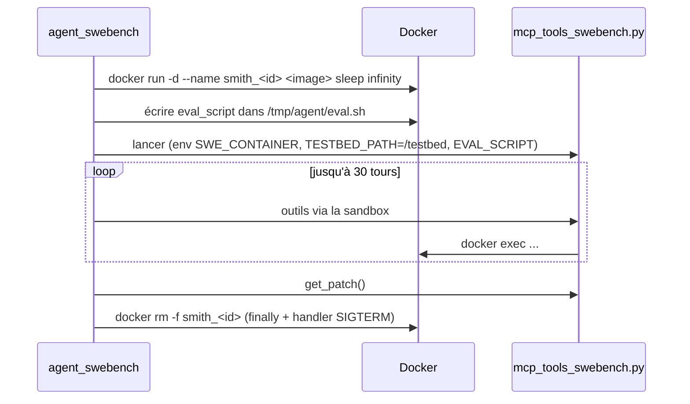

# MOD - Agent SWE-bench

## Rôle
`uv run python -m agent_swebench …` : démarre le **conteneur Docker** de la tâche, lance notre serveur MCP SWE-bench branché dessus, fait tourner la boucle, soumet `get_patch()`, et **supprime le conteneur** quoi qu'il arrive.

## Ce qui est exigé
- Mêmes 4 options que MBPP.
- Limites : **30 itérations, 300 000 entrée, 10 000 sortie, 900 s** ; **2 tâches sur 3**.
- `solution` = le **patch git** (`git -c core.fileMode=false diff`).
- **Nettoyage du conteneur** même si la moulinette nous tue (SIGTERM puis SIGKILL).
- Pas de recherche de la solution en ligne (PR, issues) : sinon **0**.

## Le cycle de vie Docker


## Fonctions à créer
| Symbole | Rôle | Appelé par | Appelle |
|---|---|---|---|
| `main()` | orchestre, écrit le JSON | `python -m agent_swebench` | tout |
| `start_container(task) -> str` | `docker run -d --name … image sleep infinity` | `main` | `subprocess.run` |
| `copy_eval_script(name, script)` | `docker exec -i name sh -c 'mkdir -p /tmp/agent && cat > /tmp/agent/eval.sh'` avec `input=script` | `main` | — |
| `remove_container(name)` | `docker rm -f`, **idempotent**, ne lève jamais | `finally`, `on_sigterm` | — |
| `on_sigterm(signum, frame)` | `raise SystemExit(1)` → déclenche les `finally` | `signal.signal(SIGTERM, …)` | — |
| `swe_fallback(sandbox)` | `get_patch()` même sans `final_answer` | [[MOD - Boucle agent]] | [[MOD - Client MCP]] `call_tool("get_patch", {})` |

## Squelette (à trous)
```python
def main():
    args = parse_args()
    task = SWEBenchTaskInput.model_validate_json(Path(args.task_file).read_text())
    name = f"smith_{task.instance_id}_{os.getpid()}"
    signal.signal(signal.SIGTERM, on_sigterm)
    solution = None
    try:
        start_container(task.docker_image, name)
        copy_eval_script(name, task.eval_script)
        env = {**os.environ, "SWE_CONTAINER": name, "TESTBED_PATH": "/testbed", "EVAL_SCRIPT": "/tmp/agent/eval.sh"}
        ...  # TODO: Sandbox + McpClient.from_stdio(..., env=env) ; run_agent(..., Limits(30, 290_000, 9_500, 850))
    except BaseException as e:            # SystemExit du SIGTERM compris
        ...  # TODO: solution d'échec avec ce qu'on a (steps partiels)
    finally:
        ...  # TODO: sandbox.close() ; remove_container(name) ; write_solution(...)
```

## Exemple de budget (30 tours)
| Poste | Par tour | × 30 |
|---|---|---|
| Sortie LLM | ~300 tokens | 9 000 / 10 000 ✅ (serré !) |
| Entrée (historique qui grossit) | 3 000 → 15 000 | ~270 000 / 300 000 ⚠️ |
Donc : observations **tronquées** (≈ 3 000 caractères), `read_file` par plages, et soumettre dès que les tests passent (« submission discipline »).

## Pièges
- `docker pull` peut être long : ⚠️ vérifier si la moulinette pré-télécharge l'image ; sinon le pull compte dans les 900 s.
- Docker Desktop sur Mac M1/M2 : les images `x86_64` tournent en émulation, **lentes** → tester aussi sur une machine Linux x86 si possible.
- Ne jamais appeler `docker rm` sur un nom vide.
- Tâches de départ conseillées par le sujet : `sympy__sympy-14711`, `sympy__sympy-13480`, `pydata__xarray-4629`.

## Notes liées
[[FLOW - Tâche SWE-bench]] · [[10 - School/10 - Agent-Smith/Index des fonctions|Index des fonctions]]
