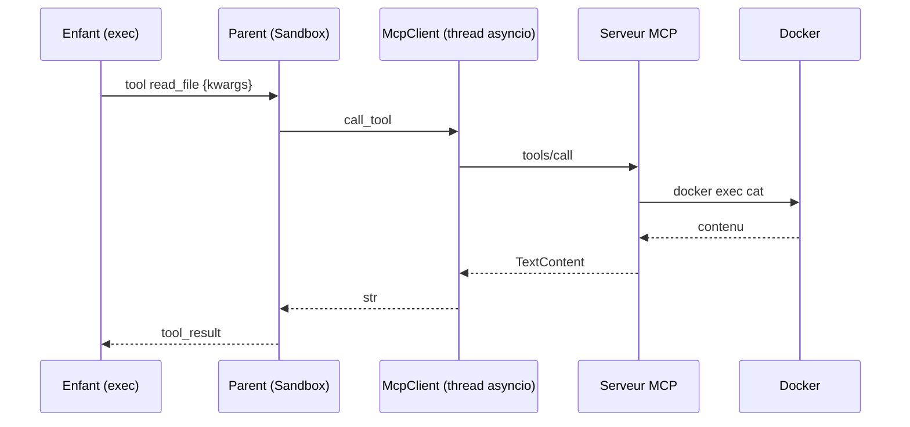

# FLOW - Appel outil MCP

## Rôle
Le trajet exact quand le code du LLM écrit `content = read_file("/testbed/a.py", 1, 50)`. C'est **le point où le travail de Sylvain et celui de Thomas se rejoignent** : à tester ensemble en premier.

## Chaîne d'appels numérotée
1. **Enfant** : `exec` arrive sur `read_file(...)` → c'est le wrapper créé par `_make_tool_wrapper(conn, "read_file")`.
2. Le wrapper mappe les positionnels : `("/testbed/a.py", 1, 50)` → `{"filepath": "/testbed/a.py", "start_line": 1, "end_line": 50}` (ordre des `properties` du schéma).
3. `conn.send({"type": "tool", "name": "read_file", "kwargs": {...}})` puis **bloque** sur `conn.recv()`.
4. **Parent** (`Sandbox.execute`) : reçoit `tool`, **met le chrono en pause**.
5. `McpClient.call_tool("read_file", kwargs)` → `run_coroutine_threadsafe(session.call_tool(...))`.
6. JSON-RPC `tools/call` → **serveur** `mcp_tools_swebench.py` → `_read("/testbed/a.py")` → `docker exec … cat` → formatage `1: …`.
7. Retour `CallToolResult(content=[TextContent(text="1: import os\n2: …")])` → texte joint.
8. Parent : `conn.send({"type": "tool_result", "ok": True, "value": texte})`, relance le chrono.
9. Enfant : le wrapper renvoie le texte → `content` est une **variable Python** (persistante au tour suivant).
10. Si le code fait `print(content)`, les chunks remontent en `stdout` → deviennent l'observation.

## Cas limites
- L'outil renvoie `isError` → le wrapper lève `RuntimeError(message)` → traceback court dans l'observation.
- Outil inconnu (faute de frappe du LLM) → `NameError` Python normal, déjà explicite.
- Le serveur MCP est mort → `call_tool` lève → message `"[MCP] server not reachable"` ; ne pas crasher la boucle.

## Notes liées
[[OVR - smith_core]] · [[FLOW - Tâche MBPP]] · [[FLOW - Tâche SWE-bench]]
