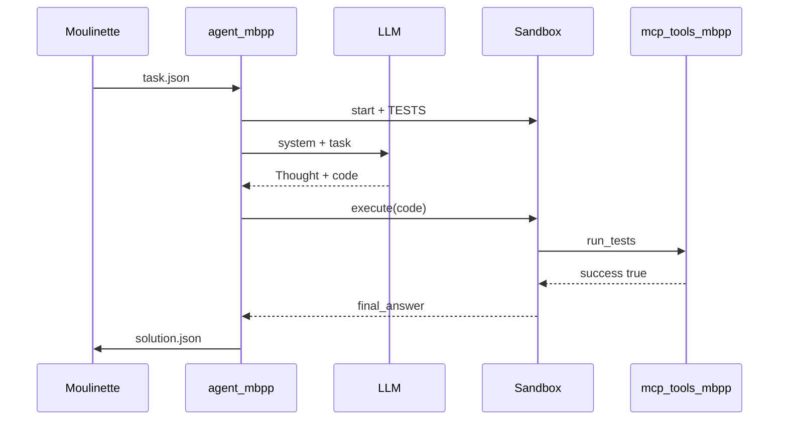

# FLOW - Tâche MBPP

## Rôle
Ce qui se passe, ligne à ligne, de `dump` à `validate`, sur un exemple réel (task 2 de MBPP).

## Chaîne d'appels numérotée
1. Moulinette : `moulinette_eval dump mbpp --output ../cache/mbpp_task.json`.
2. `agent_mbpp.main()` → `load_task` → `MBPPTaskInput(task_id=2, function_definition="def similar_elements(test_tup1, test_tup2):", test_list=[...])`.
3. `McpClient.from_stdio("…/python …/mcp_tools_mbpp.py")` → `connect()` → `list_tools()` = `[run_tests]`. ([[MOD - Client MCP]])
4. `Sandbox.start()` → enfant lancé, namespace = `{run_tests, final_answer}` + builtins sûrs. ([[MOD - Sandbox exécuteur]])
5. `sandbox.execute("TESTS = [...]")` (préparation, hors itérations).
6. `build_system_prompt(MBPP_TEMPLATE, sandbox.manual())` (~600 tokens).
7. **Itération 1** — `LLMClient.chat(messages, max_tokens=500, stop=["<end_code>"])` → 1 050 entrée, 180 sortie, 0 retry.
8. `extract_code(texte)` → code + notice vide.
9. `sandbox.execute(code)` → l'enfant appelle `run_tests(...)` → Pipe → parent → MCP → `{"success": true, ...}` → `final_answer(solution)` → `FinalAnswer` levée.
10. `ExecResult(final_answer="def similar_elements…")` → la boucle s'arrête.
11. `SolutionOutput(task_id="2", benchmark="mbpp", success=True, iterations=1, total_requests=1, total_input_tokens=1050, …)` → `write_solution`.
12. Moulinette : `validate mbpp` exécute **ses** tests sur `solution` et vérifie les limites.

## Si le test échoue au tour 1
L'observation contient `FAIL: assert …` → tour 2 avec ~1 500 tokens entrée → cumul ~2 550. Encore OK. Au tour 4 on dépasse 6 000 (voir [[MOD - Boucle agent]]) → d'où l'importance d'un prompt court et d'un bon modèle.

## Notes liées
[[FLOW - Appel outil MCP]] · [[FLOW - Tâche SWE-bench]]
