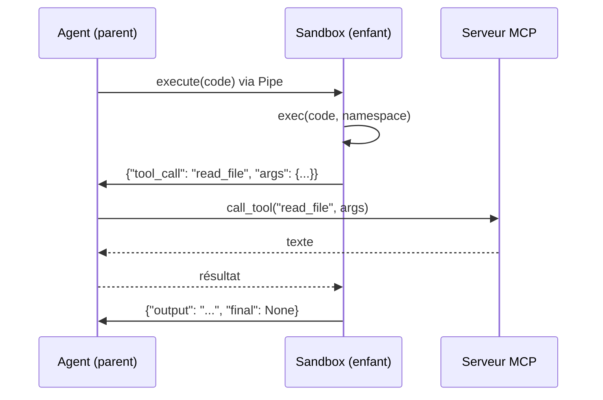

# OVR - smith_core

## Rôle
Le cœur réutilisé par les deux agents : la **boucle** (`agent/`), l'**accès LLM** (`llm/`) et la **sandbox** (`sandbox/`). `agent_mbpp` et `agent_swebench` ne font que : charger la tâche, choisir le serveur MCP, construire le prompt, lancer la boucle, écrire le JSON.

## Les vraies frontières d'exécution
Il y a **4 process** (ou 3 pour MBPP). C'est la chose la plus importante à comprendre :

| Process | Contient | Pourquoi séparé |
|---|---|---|
| **Agent** (parent) | boucle, client LLM, **client MCP** | c'est lui qui pilote ; il doit survivre à tout |
| **Sandbox** (enfant, `multiprocessing`) | `exec()` du code LLM, namespace persistant, `final_answer` | on peut le **tuer** (timeout), lui mettre une **limite mémoire** (`resource`), lui couper le réseau, sans tuer l'agent |
| **Serveur MCP** (`mcp_tools_*.py`) | les outils | imposé par le sujet : process séparé, stdio ou HTTP |
| **Conteneur Docker** (SWE-bench) | le repo `/testbed`, Python du projet, tests | imposé par SWE-bench |


⚠️ Proposition : le **client MCP vit dans le parent**, l'enfant n'a que des *wrappers* qui envoient la demande par le pipe. Avantage : l'enfant n'a besoin ni de socket ni de subprocess → on peut tout lui interdire. Le sujet dit « la sandbox contient le client MCP » : c'est vrai au niveau de la classe `Sandbox` (elle possède le client), pas du process enfant.

## Le contrat entre Sylvain et Thomas (à figer le jour 1)
C'est **la seule interface** entre la partie Sylvain (sandbox + MCP) et la partie Thomas (agent + LLM). Si elle est figée, vous codez en parallèle sans vous bloquer.
```python
class ExecResult(BaseModel):
    output: str                 # stdout + traceback + messages système, déjà tronqué
    final_answer: str | None    # non-None => la boucle s'arrête
    timed_out: bool = False
    notices: list[str] = []     # "output truncated", "state was reset", ...

class Sandbox:
    def __init__(self, config: SandboxConfig, mcp: "McpClient | None") -> None: ...
    def start(self) -> None: ...            # lance l'enfant + connecte le MCP
    def execute(self, code: str) -> ExecResult: ...
    def manual(self) -> str: ...            # texte pour le prompt
    def close(self) -> None: ...            # tue l'enfant, ferme le MCP
```
Tant que la vraie sandbox n'existe pas, Thomas peut utiliser un **faux** : `FakeSandbox.execute` qui fait `exec` sans sécurité. Même signature → on échange l'un contre l'autre sans toucher la boucle.

## Où est quoi (proposé ⚠️)
```
smith_core/
├── models.py            StepMetrics, SolutionOutput, SandboxConfig, tâches   (les deux)
├── agent/loop.py        run_agent()                                           (Thomas)
├── agent/extract.py     extract_code()                                        (Thomas)
├── agent/prompts.py     build_system_prompt()                                 (Thomas)
├── llm/client.py        LLMClient.chat()                                      (Thomas)
├── llm/keys.py          KeyRing (rotation)                                    (Thomas)
├── sandbox/executor.py  Sandbox, worker enfant                                (Sylvain)
├── sandbox/security.py  builtins restreints, import guard, audit hook         (Sylvain)
├── sandbox/mcp_client.py McpClient (stdio + HTTP)                             (Sylvain)
├── sandbox/manual.py    build_manual()                                        (Sylvain)
└── sandbox/cli.py       main() de `uv run sandbox`                            (Sylvain)
```

## Invariants
- La boucle **ne crashe jamais** : toute exception devient un `SolutionOutput(success=False, error=...)` écrit sur disque.
- Le `solution.json` est écrit **même** en cas d'échec ou de dépassement de budget.
- `KeyboardInterrupt` et `SystemExit` **remontent** jusqu'à la boucle (exigé).

## Notes liées
[[10 - School/10 - Agent-Smith/00 - Accueil|00 - Accueil]] · [[FLOW - Appel outil MCP]] · [[10 - School/10 - Agent-Smith/Index des fonctions|Index des fonctions]]
