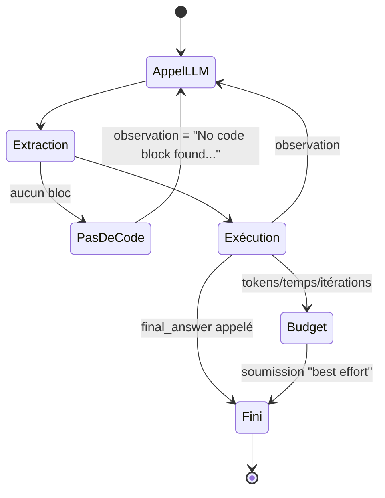

# MOD - Boucle agent

## Rôle
Le **Thought → Code → Observation** : appeler le LLM, extraire le code, l'exécuter, renvoyer l'observation, recommencer — jusqu'à `final_answer`, ou jusqu'à une limite (itérations, tokens, temps). Produit le `SolutionOutput`. **Écrite par nous** (aucune lib d'orchestration autorisée).

## Ce qui est exigé
- `max_iterations` **configurable** (paramètre de la fonction).
- Une `StepMetrics` **par itération** avec tous les champs (`llm_output` brut, `sandbox_input`, `sandbox_output`, `retries`, `api_url`, `model_name`…).
- Respect des budgets **cumulés** : on s'arrête *avant* de les dépasser.
- Ne jamais crasher : toujours écrire un JSON.

## Diagramme


## Fonctions à créer
| Symbole | Rôle | Appelé par | Appelle |
|---|---|---|---|
| `run_agent(task_id, benchmark, system_prompt, user_prompt, sandbox, llm, limits) -> SolutionOutput` | la boucle | [[MOD - Agent MBPP]], [[MOD - Agent SWE-bench]] | [[MOD - Client LLM]] `chat`, [[MOD - Extraction de code]] `extract_code`, [[MOD - Sandbox exécuteur]] `execute` |
| `Limits` (dataclass) | `max_iterations`, `max_input_tokens`, `max_output_tokens`, `timeout_s` | agents | — |
| `format_observation(result) -> str` | met les notices **avant** la sortie, tronque | `run_agent` | — |
| `budget_left(steps, limits, start) -> bool` | reste-t-il de quoi faire un tour ? | `run_agent` | — |
| `fallback_solution()` | quoi soumettre si pas de `final_answer` | `run_agent` | callback fourni par l'agent |

## Squelette (à trous)
```python
def run_agent(task_id, benchmark, system_prompt, user_prompt, sandbox, llm, limits, fallback):
    messages = [{"role": "system", "content": system_prompt},
                {"role": "user", "content": user_prompt}]
    steps: list[StepMetrics] = []
    start = time.monotonic()
    answer = None
    for i in range(1, limits.max_iterations + 1):
        if not budget_left(steps, limits, start):
            break
        resp = llm.chat(messages, max_tokens=..., stop=["<end_code>"])  # TODO: max_tokens = reste du budget sortie
        code, notice = extract_code(resp.text)
        if code is None:
            observation = notice                         # "No valid code block found..."
        else:
            result = sandbox.execute(code)
            observation = format_observation(result, notice)
            answer = result.final_answer
        steps.append(StepMetrics(step=i, input_tokens=resp.input_tokens, ...))  # TODO: tous les champs
        if answer is not None:
            break
        messages.append({"role": "assistant", "content": resp.text})
        messages.append({"role": "user", "content": "Observation:\n" + observation})
    ...  # TODO: construire SolutionOutput (success = answer is not None, solution = answer or fallback())
```

## Exemple chiffré : pourquoi 6 000 tokens MBPP, c'est peu
À chaque tour on **renvoie tout l'historique**. Avec un prompt système de 900 tokens et une tâche de 150 :
| Tour | Envoyé | Cumulé |
|---|---|---|
| 1 | 1 050 | 1 050 |
| 2 | 1 050 + 250 (réponse) + 200 (obs) = 1 500 | 2 550 |
| 3 | 1 950 | 4 500 |
| 4 | 2 400 | **6 900 ❌** |
Donc MBPP doit se résoudre en **1 à 3 tours** : prompt court, et le modèle teste + soumet **dans le même bloc** (voir [[MOD - Prompt système]]).

## Cas limites
- Le LLM ne renvoie aucun code 3 fois de suite → continuer (observation explicite), le budget finira la boucle.
- `final_answer` appelé avec un objet non-str → `str(...)`.
- Plus de budget : MBPP → soumettre le dernier code qui définit la fonction ; SWE-bench → soumettre `get_patch()` quand même (`success=False`, mais le patch peut passer les tests).
- SIGTERM de la moulinette → handler qui écrit le JSON partiel puis nettoie (voir [[MOD - Agent SWE-bench]]).

## Notes liées
[[FLOW - Tâche MBPP]] · [[FLOW - Tâche SWE-bench]] · [[10 - School/10 - Agent-Smith/Index des fonctions|Index des fonctions]]
